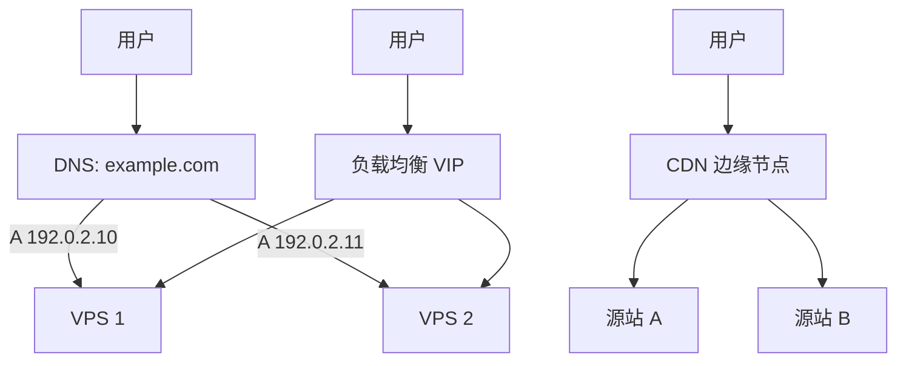

## 结论先行

- **可以。** 一个域名可以同时有多个 `A`/`AAAA` 记录，也可以在多台 VPS 的 Nginx/Apache 里都配置同一个 `server_name`。
- **但“绑定”要拆成四层**：DNS 解析、HTTP/TLS 虚拟主机、请求调度、应用状态。前两层只决定“名字能对应谁”，后两层才决定“多台机器能不能像一个服务”。
- **只加多条 A 记录，得到的是 DNS 轮询**：便宜、没有健康检查、没有会话保持，故障切换靠客户端重试和 TTL，通常不算生产级高可用。
- **生产环境更常用单入口**：域名指向负载均衡 VIP 或 CDN，后面挂多台 VPS；要秒级切换、健康检查、会话保持，别把希望押在 DNS 上。
- **面板里的“绑定域名”只是本机 vhost 配置**：在宝塔/aaPanel 两台机器上都绑定 `example.com` 完全可行，但公网请求只会去 DNS 当前解析到的那台；除非 DNS 返回多个地址，或者前面有代理。

## 一、先把“绑定”拆开

“一个域名绑定多个 VPS”在不同语境下指的不是同一件事：

| 层       | “绑定”具体是什么                        | 能否一对多             | 谁决定这次请求去哪   |
| -------- | --------------------------------------- | ---------------------- | -------------------- |
| DNS      | `example.com` 的 A/AAAA 记录集          | 可以，多条记录         | 递归解析器 + 客户端  |
| HTTP     | 每台 VPS 的 `server_name` / `Host` 匹配 | 可以，多台都配同一域名 | 收到连接的那台服务器 |
| TLS      | SNI 与证书覆盖的域名                    | 可以，每台都装证书     | TLS 终止点           |
| 调度     | LB、CDN、Anycast、DNS 轮询              | 可以                   | 调度器               |
| 应用状态 | session、上传文件、数据库、定时任务     | **不会自动共享**       | 应用架构             |

所以“能”与“不能”取决于你问的是哪一层。域名系统允许一个名字对应多个地址；HTTP 也允许很多台服务器都认为自己负责这个域名。真正难的是后两层：让流量按预期分配，以及让多台机器共享同一份状态。



三种常见形态：DNS 直接返回多个地址；域名指向一个负载均衡入口；域名指向 CDN，CDN 再回多台源站。

## 二、DNS 多 A：能通，但不是高可用

最直接的做法，是给同一个主机名配置多条地址记录：

```dns
example.com.        300  IN  A      192.0.2.10
example.com.        300  IN  A      192.0.2.11
www.example.com.    300  IN  CNAME  example.com.
```

这里的 `192.0.2.0/24` 是文档专用地址段，只作示例。实际配置时，把两条 A 记录指向两台 VPS 的公网 IPv4；如果两台都支持 IPv6，再补对应的 `AAAA`。

### 它实际发生了什么

DNS 返回的是一组地址，不是“主服务器 + 备服务器”。协议不保证顺序，递归解析器可以按自己的策略重排；权威 DNS 也常用轮询顺序来分摊查询。在本机连续查询一个双 A 记录的域名，返回顺序会在两组地址之间交替；换一个递归解析器后，TTL 从 240 降到 192，说明 TTL 是缓存剩余时间，不是“多久后切换”的倒计时。

这也是第一个容易忽略的点：**负载是按解析器分的，不是按用户分的**。一个大公司或运营商的递归解析器可能把同一顺序发给很多用户，实际流量就会偏向某一台。TTL 越短，顺序变化越频繁，但 DNS 查询也越多。

### 它能做什么

- 给无状态站点做粗略分流，成本几乎为零。
- 一台机器彻底不可达时，部分客户端会尝试下一个地址，能捞回一部分可用性。
- 配合 DNS 服务商的健康检查/故障转移（例如 Route 53、Cloudflare Load Balancing 一类产品），可以做到“DNS 层面的 failover”，但仍受 TTL 和解析器缓存约束。

### 它不能做什么

| 做不到              | 原因                                                 |
| ------------------- | ---------------------------------------------------- |
| 健康检查            | DNS 只按记录回答，不知道你的应用是否还活着           |
| 秒级切换            | 客户端和递归解析器会缓存；连接复用还会让旧连接继续跑 |
| 会话保持            | 同一用户下一次可能被解析到另一台                     |
| 按权重/地区精细调度 | 普通 A 记录没有权重；需要 GeoDNS 或专业 LB           |
| 隐藏源站            | 所有 A 记录都是公开的，攻击者可以逐个打              |
| 共享上传/数据库     | 多台机器不会因为域名相同就自动同步文件               |

还有一个常被忽略的细节：如果一台 VPS 的 443 端口挂了，但 DNS 仍然返回它的地址，浏览器不一定会立刻换一台。不同客户端的重试策略差异很大，有的会快速重试，有的会先超时几十秒；这不是可以写进 SLA 的故障切换机制。

### A 记录、CNAME 与域名的边界

- 同一主机名可以有多条 A/AAAA 记录；但 **CNAME 不能和同名的其他记录共存**。如果 `www` 是 CNAME，就不要再给它加 A 记录。
- 根域名（`example.com`）通常不能直接放 CNAME；可以用 DNS 服务商提供的 ALIAS/ANAME，或者直接配 A/AAAA。
- 多条 A 记录只解决 IPv4；如果加了 `AAAA`，要确保每台 VPS 的 IPv6 真的可用。Let's Encrypt 在验证时会优先尝试 IPv6，错误的 `AAAA` 可能让证书签发失败。
- 邮件路由看 MX 记录，不看 A 记录：多条 A 不会影响收信；但如果多台 VPS 都要发信，每台的公网 IP 都要有匹配的 PTR，并纳入 SPF/DKIM/DMARC，否则容易进垃圾箱。
- 如果使用 CDN，通常是把 `www` CNAME 到 CDN 提供的域名，源站地址藏在 CDN 后面；这属于下一节的“多源站”，不是裸 DNS 轮询。

## 三、反向代理/LB：生产环境最常见的答案

要让多台 VPS 真正“像一个服务”，最常见的做法是加一个入口：

```text
用户 → example.com（一条 A 记录）→ 负载均衡 VIP → VPS 1 / VPS 2 / VPS 3
```

DNS 只指向负载均衡的地址；由负载均衡决定每次请求去哪个后端。这样健康检查、TLS 终止、会话保持、限流、访问日志都可以在入口统一做。

### Nginx 示例

```nginx
upstream app {
    least_conn;
    server 10.0.0.11:8080 max_fails=3 fail_timeout=10s;
    server 10.0.0.12:8080 max_fails=3 fail_timeout=10s;
    server 10.0.0.13:8080 backup;
    keepalive 32;
}

server {
    listen 443 ssl;
    http2 on;
    server_name example.com;

    ssl_certificate     /etc/letsencrypt/live/example.com/fullchain.pem;
    ssl_certificate_key /etc/letsencrypt/live/example.com/privkey.pem;

    location / {
        proxy_pass http://app;
        proxy_http_version 1.1;
        proxy_set_header Host              $host;
        proxy_set_header X-Real-IP         $remote_addr;
        proxy_set_header X-Forwarded-For   $proxy_add_x_forwarded_for;
        proxy_set_header X-Forwarded-Proto $scheme;
        proxy_set_header Connection        "";
    }
}
```

几个关键点：

- `max_fails` / `fail_timeout` 是 **被动健康检查**：只有真实请求失败到阈值，Nginx 才暂时把后端摘掉。开源版 Nginx 没有主动探测；需要主动健康检查时，通常用 Nginx Plus、HAProxy，或额外的监控/服务发现。
- `backup` 只在主后端都不可用时才接管，适合做冷备，不等于“自动扩容”。
- `least_conn` 按当前连接数分配，比单纯轮询更适合长连接；但真正均匀与否还取决于请求耗时。
- `proxy_next_upstream` 默认会在连接错误/超时等情况下尝试下一个后端；对非幂等请求（比如扣款）要谨慎，避免重复执行。
- 后端应用要正确识别 `X-Forwarded-For` / `X-Forwarded-Proto`，并且只信任来自负载均衡的这类头；否则客户端可以伪造 IP 和协议。

### 负载均衡自己也不能是单点

只有一台 Nginx 的“负载均衡”只是把单点从应用层挪到了入口层。生产环境至少要考虑：

- 两台负载均衡 + Keepalived/VRRP 浮动 VIP；或
- 云厂商的托管 LB（多可用区、自带健康检查）；或
- DNS 指向多个 LB 地址，但这又回到了客户端重试的老问题。

### 会话与状态：比“怎么分流”更难

多台 VPS 最常见的翻车点不是流量分配，而是状态：

| 状态         | 只做 DNS/LB 会发生什么             | 常见做法                                  |
| ------------ | ---------------------------------- | ----------------------------------------- |
| 登录 session | 用户下一次被分到另一台，登录态丢失 | 共享 Redis/数据库；或粘性会话（只能缓解） |
| 上传文件     | 文件只落在一台，另一台读不到       | 对象存储、NFS、分布式文件系统             |
| 本地缓存     | 各台缓存不一致                     | 集中缓存或带失效广播                      |
| 定时任务     | 每台都跑一遍，重复执行             | 选主/分布式锁/独立 worker                 |
| 数据库       | 数据库本身成为新单点               | 主从、故障转移、备份与演练                |
| 部署版本     | 两台代码版本不一致                 | 滚动发布、健康检查、连接 draining         |

粘性会话（`ip_hash`、cookie 粘滞）能让同一用户尽量回到同一台，但它只是把问题推迟：机器挂了，会话还是会丢；扩缩容时也会倾斜。能共享的状态尽量共享，粘性只作为过渡手段。

## 四、CDN 多源站：把多台 VPS 藏在一个域名后面

如果站点面向公网、以静态内容为主，CDN 往往比自建 LB 更合适：

```text
用户 → example.com（CNAME 到 CDN）→ CDN 边缘节点 → 源站池（VPS 1 / VPS 2）
```

- 域名通常 CNAME 到 CDN 提供的接入域名；根域名用 ALIAS/ANAME 或 CNAME flattening。
- CDN 边缘节点做 TLS 终止、缓存、压缩、WAF、DDoS 清洗；回源时再走源站池。
- 源站池可以配置健康检查、主备/权重、回源超时；一台源站挂了，CDN 可以切到另一台。
- 源站只允许 CDN 回源地址访问，能隐藏 VPS 公网 IP，减少被直接攻击的面。
- 证书分两段：边缘证书（CDN 管理）和回源证书（源站或 CDN 托管）。开“严格回源”时，源站证书也要有效。

CDN 不是“多台 VPS 自动同步”。它缓存的是响应；动态请求仍会回源。多台源站必须提供一致的内容和会话逻辑状态，否则用户会在不同源站之间看到不同数据。缓存键、Cookie、`Vary`、发布后的 purge 都要设计好。

## 五、Anycast：同一个 IP 出现在多个机房

还有一种是“同一个 IP 在多地进行 BGP Anycast 宣告”：用户被网络路由到最近/最优的机房。DNS 根服务器、公共 DNS、CDN 和 DDoS 清洗网络大量使用这种方式。

它的门槛不在 DNS，而在网络：需要 ASN、独立 IP 段、BGP 运维能力，以及与上游/机房的对等安排。普通 VPS 用户通常做不到，也不建议为了“一个域名多台 VPS”去上 Anycast。另一个现实问题是长连接：路由变化可能让同一 TCP 连接的后继包走到另一个机房，因此 Anycast 服务通常需要仔细处理连接一致性和状态同步。

## 六、子域、端口、路径：更清晰的拆分方式

很多“一个域名绑多台 VPS”的需求，其实可以拆成多个主机名或路径：

| 需求           | 写法                                                    | 说明                                                  |
| -------------- | ------------------------------------------------------- | ----------------------------------------------------- |
| 不同服务       | `www.example.com`、`api.example.com`、`img.example.com` | 各自 A/CNAME，证书和发布互不影响                      |
| 同一服务多实例 | `example.com` → LB → 多台 VPS                           | 这才是“一个主机名多台机器”的典型场景                  |
| 同域名不同端口 | `example.com:8080`                                      | 能用，但用户不友好；浏览器不会用 SRV 记录找 HTTP 服务 |
| 同域名不同路径 | `example.com/api` → 后端 B                              | 由反向代理按 path 分流，仍然是同一入口                |
| 多租户         | `*.example.com`                                         | 泛解析 + 泛域名证书，注意证书和隔离                   |

严格说，`api.example.com` 和 `www.example.com` 是同一个注册域名下的不同主机名；它们可以各自指向不同 VPS，配置和证书也彼此独立。对大多数业务，这比“一个主机名硬塞多台机器”更容易维护。

## 七、八个常见坑

### 1. 证书验证打到哪台不确定

Let's Encrypt 的 HTTP-01 验证会从多个网络位置、可能多次请求 `http://<域名>/.well-known/acme-challenge/`。如果域名有多条 A 记录，验证请求可能落到任意一台；每台都必须能返回同一个 token，否则签发会随机失败。官方文档也明确提醒：有多台 Web 服务器时，要确保文件在每一台上都可用。

更稳的做法：

- 用 DNS-01 验证，签发泛域名证书，再把证书分发到各台；或
- 在负载均衡/入口统一终止 TLS，源站用内部 CA 或自签证书；或
- 每台都用 DNS-01 单独续期，避免 HTTP-01 的落点问题。

### 2. 会话、上传、定时任务没有共享

这是“多台 VPS 看起来能访问，但用户一刷新就掉登录”的根源。先列清楚应用有哪些本地状态，再决定共享存储、粘性会话还是无状态化。不要指望 DNS 或 Nginx 自动解决。

### 3. 把 TTL 当成切换开关

TTL 是“允许缓存多久”，不是“多久一定生效”。递归解析器会缓存，操作系统和浏览器也会缓存，HTTP/2/HTTPS 连接还可能被复用。准备切流量时，提前把 TTL 调低，观察旧 TTL 走完，再切；切完不要立刻删旧记录。

### 4. 健康检查写成假健康

`return 200` 的 `/healthz` 只能证明 Nginx 还活着，不能证明应用、数据库、缓存都正常。健康检查至少覆盖“能处理真实请求”的关键依赖；同时要防止依赖抖动导致所有节点一起被摘除。检查频率、超时、失败阈值和恢复阈值都要按业务调。

### 5. 数据库变成新的单点

应用从一台变两台，数据库还是那一台；数据库挂了，两台应用一起挂。多 VPS 不等于高可用，数据层要单独设计：主从/多副本、故障转移、备份恢复演练、连接池重连。

### 6. 多台 VPS 在同一个故障域

三台 VPS 都开在同一家云、同一个可用区，甚至同一台宿主机上，机房网络或母机维护会一起下线。真要容灾，至少跨可用区；跨地域还要考虑数据复制延迟和一致性。

### 7. 源站 IP 暴露

多条 A 记录会把所有 VPS 地址公开；攻击者可以绕过 CDN/WAF 直接打源站。使用 CDN 时，源站防火墙只放行 CDN 回源段，定期检查 DNS 历史记录和证书透明日志是否泄露了源站 IP。

### 8. SEO 与内容一致性

搜索引擎通常能处理一个主机名对应多个 IP，但如果不同 IP 返回不同内容，就可能被当成不同页面，甚至触发 cloaking 风险。多台源站要返回同一份内容；需要区分地区时，用明确的 hreflang/canonical 和独立主机名，而不是偷偷按 IP 返回不同页面。

## 八、怎么选

| 场景                             | 建议                                            | 说明                                   |
| -------------------------------- | ----------------------------------------------- | -------------------------------------- |
| 个人静态博客、展示站，1–2 台 VPS | DNS 多 A + 监控 + 备份                          | 成本最低；能接受分钟级中断再选         |
| 小型动态站，有登录               | 单入口 Nginx/HAProxy + 2 台 VPS + 共享 Redis/DB | 比 DNS 轮询可控；注意 LB 自身别成单点  |
| 生产 API，要求秒级切换           | 云 LB 或 HAProxy 主备 + 健康检查 + 多可用区     | DNS 只指向 LB，不直接把用户暴露给后端  |
| 全球静态资源                     | CDN + 对象存储                                  | VPS 只做源站；缓存和边缘 TLS 交给 CDN  |
| 全球动态应用                     | CDN/全球加速 + 区域 LB + 数据复制               | 复杂度最高；先确认数据一致性方案       |
| 不同服务                         | 子域拆分                                        | `www`、`api`、`img` 各自独立，故障隔离 |
| 抗 DDoS、隐藏源站                | CDN/WAF + 源站白名单                            | 不要把所有源站 IP 放进公开 DNS         |
| 只有一台 VPS                     | 单 A + 快照/备份                                | 多 A 没有意义；先做备份和监控          |

一个简单的判断顺序：

1. 先问“多台 VPS 是不是必须的？”如果只是流量小、预算有限，单台 + 备份更简单。
2. 再问“能不能接受分钟级中断？”能，DNS 多 A + 监控；不能，上 LB。
3. 再问“是否面向全球、是否需要抗 DDoS？”需要，CDN/WAF。
4. 最后问“状态放哪？”会话、文件、数据库、定时任务，逐项给出共享或选主方案。

## 九、最小验证清单

配置完不要只看“网页能打开”，至少验证下面几项。

### 1. 看 DNS 实际返回什么

```bash
dig +noall +answer A example.com
dig +noall +answer AAAA example.com

# 换一个递归解析器，比较结果与 TTL
dig @1.1.1.1 +short A example.com
dig @8.8.8.8 +short A example.com
```

重点看：地址条数、TTL 剩余值、是否存在不该有的 `AAAA`、不同解析器结果是否一致。

### 2. 绕过 DNS，逐台验证

```bash
for ip in 192.0.2.10 192.0.2.11; do
    curl -sS --resolve "example.com:443:$ip" -o /dev/null \
        -w "$ip  %{http_code}  %{time_total}s\n" \
        https://example.com/
done
```

`--resolve` 让 curl 直接连指定 IP，但仍然发送 `Host: example.com` 和 SNI，因此能验证每台 VPS 的虚拟主机、证书和响应是否都正确。如果本机走了 HTTP 代理，`%{remote_ip}` 可能显示代理地址；测试时加 `--noproxy '*'` 或看 `curl -v` 的连接目标。

### 3. 看证书

```bash
openssl s_client -connect 192.0.2.10:443 -servername example.com </dev/null 2>/dev/null \
    | openssl x509 -noout -subject -issuer -dates
```

每台都要检查：证书是否覆盖 `example.com`、是否过期、链是否完整。多个源站使用不同证书时，客户端可能因为连接到不同机器而看到不同证书。

### 4. 测故障切换

先记录正常时每台的响应，再停掉一台（或封掉它的 443），用循环请求观察：

```bash
while true; do
    curl -sS -o /dev/null -w '%{http_code} %{time_total}\n' https://example.com/
    sleep 1
done
```

DNS 轮询下，你会看到一部分请求超时/失败，直到客户端重试或 TTL 过期；LB 下，健康检查摘除后应该很快恢复。这个测试比看配置文件更能说明真实行为。

### 5. 测会话与上传

登录后连续刷新多次，确认不会因为切换机器而掉登录；上传一个文件，再从另一台读取；触发一次定时任务，确认没有重复执行。多台 VPS 的问题，最后都会落到这些具体操作上。

## 十、结论

一个域名当然可以“绑定”多个 VPS：DNS 可以返回多个地址，多台 VPS 也都可以配置同一个域名。但要把这件事做成可用的架构，关键不在“能不能加记录”，而在：

- 你要的是**分流**、**容灾**，还是**全球加速**？
- 你能接受多长的故障切换时间？
- 会话、文件、数据库、定时任务准备放在哪？
- 入口（DNS/LB/CDN）本身是不是单点？

个人静态站，DNS 多 A 就够；小型动态站，单入口反向代理更稳；生产系统，托管 LB + 多可用区 + 共享状态；全球业务，再考虑 CDN 和 Anycast。**域名只是名字，真正决定多台 VPS 能不能像一个服务的是调度与状态。**

## 参考

- [RFC 1034: Domain Names — Concepts and Facilities](https://www.rfc-editor.org/rfc/rfc1034.html)
- [RFC 1035: Domain Names — Implementation and Specification](https://www.rfc-editor.org/rfc/rfc1035.html)
- [RFC 1794: DNS Support for Load Balancing](https://www.rfc-editor.org/rfc/rfc1794.html)
- [RFC 8305: Happy Eyeballs Version 2](https://www.rfc-editor.org/rfc/rfc8305.html)
- [RFC 2782: A DNS RR for specifying the location of services (SRV)](https://www.rfc-editor.org/rfc/rfc2782.html)
- [Let's Encrypt: Challenge Types](https://letsencrypt.org/docs/challenge-types/)
- [Let's Encrypt: IPv6 Support](https://letsencrypt.org/docs/ipv6-support/)
- [Cloudflare DNS: Round-robin DNS](https://developers.cloudflare.com/dns/manage-dns-records/how-to/round-robin-dns/)
- [NGINX: HTTP Health Checks](https://docs.nginx.com/nginx/admin-guide/load-balancer/http-health-check/)
- [Google Search Central: Consolidate duplicate URLs](https://developers.google.com/search/docs/crawling-indexing/consolidate-duplicate-urls)
