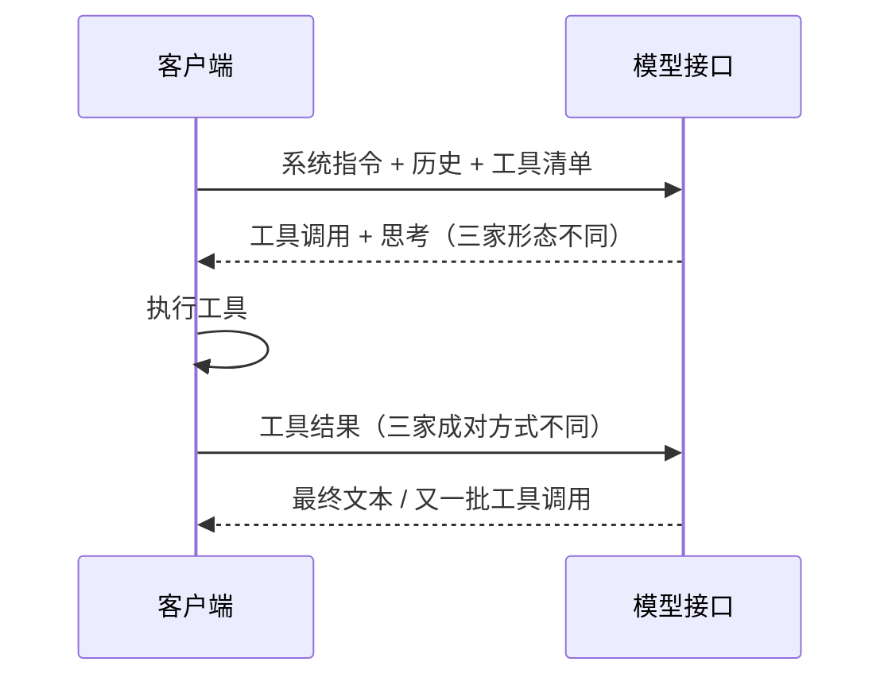

## 要点

- ReAct 在协议层没有特殊语法：一次请求产出一条带工具调用的助手消息，客户端执行后把结果作为下一条输入发回去，直到响应里不再有工具调用。
- 三家的差别只有三处：**工具调用与结果如何成对关联**、**用什么标记"这一轮还没说完"**、**思考结果能不能回传给模型**。
- 思考回传是硬约束而非优化项：Responses 漏掉 reasoning item 只是失去连续性，Anthropic 改动 thinking 块直接 400。

## 机制

一轮 ReAct 由四段构成，顺序固定：

1. **设定**：系统指令 + 工具清单，每次请求都在场。
2. **推理与动作**：模型输出文本与工具调用（可能并行多个）。
3. **观察**：客户端执行工具，把结果按协议要求的形状回填。
4. **判定**：响应里还有工具调用就回到第 2 步，否则循环结束。

三类接口对第 4 步的标记方式不同：Chat Completions 看 `finish_reason`，Anthropic 看 `stop_reason: "tool_use"`，Responses 看 `output` 里有没有 `function_call` 项——它在一次请求内就能由服务端跑完内置工具，所以"循环"可能整个发生在服务端。



## 三类接口对照

| 维度     | Chat Completions                                                  | Responses                                                       | Anthropic Messages                                         |
| -------- | ----------------------------------------------------------------- | --------------------------------------------------------------- | ---------------------------------------------------------- |
| 输入容器 | `messages[]`，按 role 排                                          | `input`，字符串或 item 数组                                     | `messages[]`，只能 user / assistant                        |
| 系统指令 | `system` 消息；o1 起用 `developer` 消息                           | 顶层 `instructions`，或 input 里的 system/developer item        | 顶层 `system`（字符串或 block 数组，可带 `cache_control`） |
| 工具定义 | `{"type":"function","function":{…}}`（外部标签）                  | `{"type":"function","name":…,"parameters":…}`（内部标签）       | `{"name","description","input_schema"}`                    |
| 工具调用 | `assistant.tool_calls[]`，`function.arguments` 是 JSON **字符串** | `output[]` 里 `type:"function_call"`，同样 `arguments` 是字符串 | assistant 内容块 `type:"tool_use"`，`input` 是**对象**     |
| 结果回传 | `{"role":"tool","tool_call_id":…,"content":…}`                    | `{"type":"function_call_output","call_id":…,"output":…}`        | user 消息里的 `type:"tool_result"` 块，带 `tool_use_id`    |
| 思考结果 | 不返回，只有 `usage` 计数                                         | `type:"reasoning"` 的 output item                               | assistant 内容块 `type:"thinking"` + `signature`           |
| 继续条件 | `finish_reason: "tool_calls"`                                     | `output` 里有 `function_call`                                   | `stop_reason: "tool_use"`                                  |
| 状态托管 | 无，客户端自己攒 `messages`                                       | `previous_response_id` 或自行回放                               | 无，客户端自己攒 `messages`                                |

## 系统消息怎么发

**Chat Completions** 把系统指令当普通消息放在数组头部，o1 之后推荐 `developer`：

```json
{
    "messages": [
        { "role": "developer", "content": "You are a coding agent." },
        { "role": "user", "content": "修掉这个测试" }
    ]
}
```

工具定义不占 messages 位置，而是被注入系统消息区渲染，因此工具 schema 越多，每轮输入 token 越多——这也是 tool search / 延迟加载存在的理由。

**Responses** 把系统指令提到顶层 `instructions`，与 `input` 分离：

```json
{ "instructions": "You are a coding agent.", "input": "修掉这个测试" }
```

注意 `previous_response_id` **不继承** `instructions`，链式调用每次都要重发，否则第二轮起人设消失。

**Anthropic** 的 `system` 是顶层参数，不在 `messages` 里；写成 block 数组才能挂缓存断点：

```json
{
    "system": [{ "type": "text", "text": "You are a coding agent.", "cache_control": { "type": "ephemeral" } }],
    "messages": [{ "role": "user", "content": "修掉这个测试" }]
}
```

`messages` 必须 user / assistant 交替，连续同角色会被合并；最后一条可以是 assistant（prefill），但新模型可能直接 400。

## 工具调用怎么来回

**Chat Completions** 一次响应只有一条 assistant 消息，多个调用并排放在 `tool_calls` 里，结果逐条回填，`id` 与 `tool_call_id` 配对：

```json
{"role":"assistant","content":null,"tool_calls":[
  {"id":"call_1","type":"function","function":{"name":"read_file","arguments":"{\"path\":\"a.ts\"}"}}]}
{"role":"tool","tool_call_id":"call_1","content":"export const a = 1"}
```

模型不保证 `arguments` 是合法 JSON，落地前必须校验；并行调用可用 `parallel_tool_calls: false` 关掉。

**Responses** 把调用与结果拆成两个 item，用 `call_id` 关联，且必须**按原顺序整体回放** `output`——其中包括 reasoning item：

```json
{"type":"function_call","call_id":"call_1","name":"read_file","arguments":"{\"path\":\"a.ts\"}"}
{"type":"function_call_output","call_id":"call_1","output":"export const a = 1"}
```

`function_call_output.output` 除了字符串还能放图片/文件内容块；内置工具（web search、code interpreter、MCP）由服务端执行，客户端只看到 `web_search_call` 之类的 item。

**Anthropic** 的 tool_use 是 assistant 内容里的一块，tool_result 是**下一条 user 消息**里的块，必须紧跟它回答的那个调用：

```json
{"role":"assistant","content":[{"type":"tool_use","id":"toolu_1","name":"read_file","input":{"path":"a.ts"}}]}
{"role":"user","content":[{"type":"tool_result","tool_use_id":"toolu_1","content":"export const a = 1"}]}
```

失败结果用 `is_error: true` 标记，不要把错误文本当正常输出塞回去。

## 思考消息怎么来回

**Chat Completions**：思考不进协议。客户端只有 `reasoning_effort` 与 `max_completion_tokens` 两个旋钮，以及 `usage.completion_tokens_details.reasoning_tokens` 这一个事后计数。由此带来两条现实限制：从 GPT-5.4 起，`reasoning_effort` 非 `none` 时 Chat Completions 不支持工具调用；GPT-6 Astra / 6.1 Sol 的工具调用只走 Responses。

**Responses**：思考是独立的 output item，`summary` 数组是可读摘要（要 `reasoning.summary` 显式打开），`encrypted_content` 是不能读但能回放的密文。

```json
{ "type": "reasoning", "id": "rs_1", "summary": [{ "type": "summary_text", "text": "先读文件再改" }] }
```

规则有三条：与 `function_call` 一起原样回放；跨轮是否生效由 `reasoning.context`（`current_turn` / `all_turns`）与模型决定；不要改动 reasoning item 之前的前缀，GPT-6.2 起插入或修改历史会让 API 直接丢弃该 item（`input_transformations` 里报 `prefix_mismatch`）。想让思考不落库，用 `store: false`，此时每个 reasoning item 自带 `encrypted_content`，回放即可续上。

**Anthropic**：`thinking` 块在正文之前，`signature` 是加密后的完整思考，`display: "omitted"` 时文本为空、签名照旧。

```json
{"type":"thinking","thinking":"","signature":"EosnCkYICxIM..."}
{"type":"text","text":"改好了"}
```

必须整块原样回传、顺序不变，改一个字符就是 400（`invalid_request_error`）。最新一代模型默认 `adaptive` 思考、`display: "omitted"`；手工 `type:"enabled"` + `budget_tokens` 在 4.7 及以后直接 400，控制深度改用 `output_config.effort`。工具循环里思考可以出现在两个 tool_use 之间（interleaved），一轮 assistant turn 内的思考必须在同一模式下产生；中途切换 thinking 配置不会报错，但会被静默降级。

## 规则与取值

| 条件                                                          | 结果                                                   |
| ------------------------------------------------------------- | ------------------------------------------------------ |
| Chat Completions `content` 为 null 但有 `tool_calls`          | 合法，这是纯工具调用响应                               |
| Chat Completions 漏回某个 `tool_call_id`                      | 多数实现直接报错，调用与结果必须一一对应（未逐家实测） |
| Responses 漏回 reasoning item                                 | 不报错，只是失去思考连续性                             |
| Responses 用 `previous_response_id` 却没重发 `instructions`   | 系统指令丢失                                           |
| Responses 改动 reasoning item 之前的历史                      | GPT-6.2 起该 item 被丢弃                               |
| Anthropic 改 thinking 块或调整顺序                            | 400                                                    |
| Anthropic 返回 `stop_reason: "tool_use"` 却没回 `tool_result` | 下一轮报错，结果必须紧跟对应调用（未实测）             |
| Anthropic 在工具循环中途改 thinking 配置                      | 静默关闭思考，不报错                                   |
| 三家任一把工具 schema 放太多                                  | 每轮都付输入 token，思考也一样                         |

## 边界

- 结论来自官方文档，读取日期 2026-11-18：OpenAI 的 Responses / Chat Completions 参考与迁移、推理、函数调用指南，Anthropic 的 Messages 参考与 thinking 文档（`anthropic-version: 2026-10-21`）。
- 未在本机发过真实请求，模型能力矩阵随版本移动很快，具体模型支持以文档表格为准。
- 第三方兼容层（vLLM、OpenRouter、各类自建代理）常在 assistant 消息里加 `reasoning_content` 之类私有字段，那是扩展而非任一官方协议，跨供应商移植时不成立。
- 只讲"消息怎么摆"，不讲提示工程、并行工具调度和上下文压缩策略。

## 参考

- <https://platform.openai.com/docs/api-reference/chat/create>：Chat Completions 的 `messages` 联合类型与 `tool_calls` 结构
- <https://platform.openai.com/docs/api-reference/responses/create>：Responses 的 item 清单与 `include`、`reasoning.encrypted_content`
- <https://platform.openai.com/docs/guides/migrate-to-responses>：messages 与 items 的逐项映射，以及两者的能力差异
- <https://platform.openai.com/docs/guides/reasoning>：reasoning item、`reasoning.context`、前缀一致性与 `phase`
- <https://platform.openai.com/docs/guides/function-calling>：`function_call` / `function_call_output` 与 strict 模式
- <https://docs.claude.com/en/api/messages>：`system`、`tool_use`、`tool_result`、`thinking` 各块定义
- <https://docs.claude.com/en/docs/build-with-claude/thinking>：思考块回传规则、`display`、模型能力表
- [dsh 上下文注入机制：pre-step 追加消息与 time-context 排程](../explore/dsh-context-injection.md)：harness 如何把上面这些协议差异收拢成统一的消息模型
