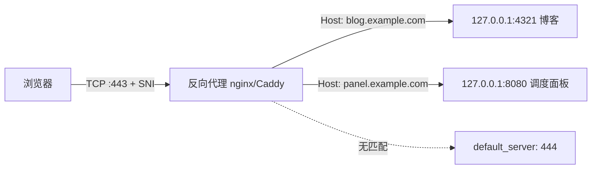

## 要点

- 一个公网 IP 的 80/443 可以同时服务任意多个域名，不需要额外 IP，也不需要额外端口。
- TLS 握手阶段按 SNI 选证书与 server 块；握手之后按 `Host`（HTTP/2、HTTP/3 是 `:authority`）选站点。
- 同一 `IP:port` 只能有一个监听者，所以入口必须是**一个**反向代理，后端服务退到 `127.0.0.1:<port>`。

## 机制

1. 客户端查 DNS：`blog.example.com` 与 `panel.example.com` 各一条 A 记录，都指向同一个公网 IP。
2. 连到 `IP:443` 后发 ClientHello，里面带 `SNI=blog.example.com`；反向代理据此选出对应证书完成握手。
3. 握手完成后读请求的 `Host` 头，匹配 `server_name` / `Host` 规则，把请求转给该站点的后端端口。
4. SNI 缺失或 `Host` 匹配不上时，落到 `default_server`——通常是返回 444 或一张占位证书。



## 规则与取值

| 条件                             | 结果                                                       |
| -------------------------------- | ---------------------------------------------------------- |
| 多个域名解析到同一 IP            | 都进同一个入口进程，互不干扰                               |
| 任意 `IP:port` 上一个监听者      | 第二个进程 `bind` 失败（`EADDRINUSE`），不能靠端口区分站点 |
| SNI 缺失（老客户端、按 IP 直连） | 拿到默认 server 的证书，浏览器报名称不匹配                 |
| `Host` 不匹配任何 `server_name`  | 落到 `default_server`，建议直接 `return 444`               |
| 只放行 443、封掉 80              | HTTP-01 续期失败，得换 DNS-01 或 TLS-ALPN-01               |
| 泛解析 `*.example.com`           | 需要泛域名证书，HTTP-01 不签发通配符，只能 DNS-01          |
| `ssl_protocols` 等握手期指令     | 只从 `default_server` 生效，写在别的 server 块里会被忽略   |
| 子域名只是「不好猜」             | 不算访问控制，仍需 basic auth、IP 白名单或 VPN             |

## 示例

nginx：两个域名两个 `server` 块，80 只做跳转和 ACME 验证，443 各自转发到本地后端。

```nginx
# /etc/nginx/conf.d/sites.conf
map $http_upgrade $connection_upgrade { default upgrade; '' close; }

server {
    listen 80;
    server_name blog.example.com panel.example.com;
    location /.well-known/acme-challenge/ { root /var/www/certbot; }
    location / { return 301 https://$host$request_uri; }
}

server {
    listen 443 ssl;
    http2 on;
    server_name blog.example.com;
    ssl_certificate     /etc/letsencrypt/live/blog.example.com/fullchain.pem;
    ssl_certificate_key /etc/letsencrypt/live/blog.example.com/privkey.pem;

    location / {
        proxy_pass http://127.0.0.1:4321;
        proxy_set_header Host              $host;
        proxy_set_header X-Forwarded-For   $proxy_add_x_forwarded_for;
        proxy_set_header X-Forwarded-Proto $scheme;
    }
}

server {
    listen 443 ssl;
    http2 on;
    server_name panel.example.com;
    ssl_certificate     /etc/letsencrypt/live/panel.example.com/fullchain.pem;
    ssl_certificate_key /etc/letsencrypt/live/panel.example.com/privkey.pem;

    # 面板额外加一层：auth_basic 或 allow/deny，二选一
    # auth_basic "panel"; auth_basic_user_file /etc/nginx/panel.htpasswd;

    location / {
        proxy_pass http://127.0.0.1:8080;
        proxy_http_version 1.1;
        proxy_set_header Upgrade    $http_upgrade;
        proxy_set_header Connection $connection_upgrade;
        proxy_buffering off;
        proxy_read_timeout 1h;
        proxy_set_header Host $host;
    }
}
```

Caddy 等价配置，证书自动申请自动续期，80/443 必须可达：

```caddyfile
blog.example.com {
    reverse_proxy 127.0.0.1:4321
}

panel.example.com {
    basic_auth {
        admin $2a$14$Zkx19XLiW6VYouLHR5NmfOFU0z2GTNmpkT/5qqR7hx4IjWJPDhjvG
    }
    reverse_proxy 127.0.0.1:8080
}
```

不改 DNS 也能验证映射，`--resolve` 直接指定 IP：

```bash
for h in blog.example.com panel.example.com; do
  echo -n "$h -> "; curl -sI --resolve "$h:443:192.0.2.10" "https://$h/" | head -1
done

# 看每个域名实际拿到哪张证书
openssl s_client -connect 192.0.2.10:443 -servername panel.example.com </dev/null 2>/dev/null \
  | openssl x509 -noout -subject -ext subjectAltName
```

两条命令都返回 200、`subject` 是各自域名，说明 SNI 与 Host 两层都匹配上了。把 `server_name` 或 `--resolve` 里的名字换成不存在的域名，会看到 444 或证书名称不匹配——这就是默认 server 兜底的行为。

## 与相邻概念的区别

| 概念                  | 差别                                                        |
| --------------------- | ----------------------------------------------------------- |
| DNS 多 A 记录         | 一个名字 → 多台机器；这里是多个名字 → 一台机器              |
| `location` 按路径分流 | 同一个域名下分后端，`Host` 相同                             |
| 多端口（`:8080`）     | 是另一个监听，不能和 443 共享同一连接                       |
| 泛域名证书            | 一张证书覆盖多个名字，但选证书仍按 SNI 逐次匹配             |
| CDN 前置              | 边缘按 SNI 分流后再回源，源站看到的 `Host` 可能与客户端不同 |

## 边界

- 不带 SNI 的客户端（很老的浏览器、部分爬虫和监控探针）只能看到默认证书，会报 `certificate name mismatch`。
- 反向代理是新的单点：它挂了，所有站点一起不可用；重启 reload 也会短暂影响全部域名。
- 面板类后端多用 SSE 或 WebSocket（日志流、web 终端），必须 `proxy_buffering off` 并且传 `Upgrade`，否则长连接会被截断成一次性响应。
- 只开 443 的机器上，certbot 的 `--standalone` 会抢不到端口，要和反代共用 webroot 或改用 DNS-01。
- 以上都是 7 层。要在 4 层按域名分流得用 SNI 代理（HAProxy `req_ssl_sni`、nginx `stream` + `ssl_preread`），代价是拿不到路径与 Host 头。

## 参考

- [nginx server_names](https://nginx.org/en/docs/http/server_names.html)（SNI → 请求行 → Host 的选择顺序、默认 server 语义）
- [RFC 6066 §3 Server Name Indication](https://www.rfc-editor.org/rfc/rfc6066#section-3)
- [Caddy automatic HTTPS](https://caddyserver.com/docs/automatic-https)
- [basic_auth（Caddyfile 指令）](https://caddyserver.com/docs/caddyfile/directives/basic_auth)
- [一个域名可以绑定多个 VPS 吗？](../experience/domain-multiple-vps.md)
